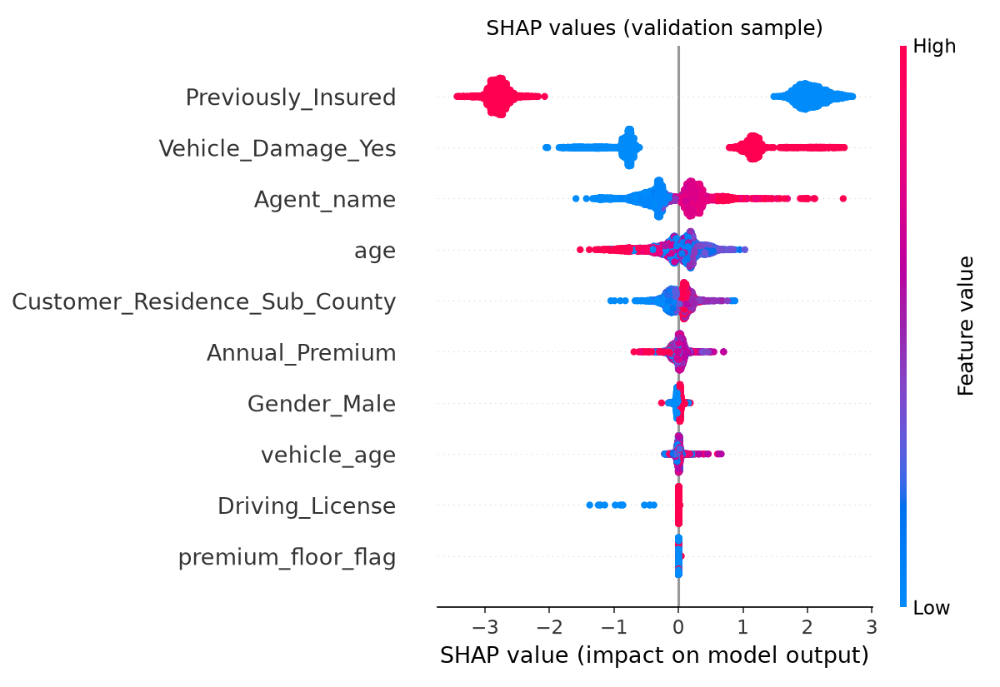

## Machine Learning for Vehicle Insurance Cross-Sell Response Prediction and Customer Prioritisation
# Machine Learning for Vehicle Insurance Cross-Sell Response Prediction and Customer Prioritisation

Predicts whether an existing **life-insurance policyholder** will take up a **vehicle-insurance** offer, and ranks customers so a limited outreach budget goes to those most likely to say yes.

**DSA 8401 – Applied Machine Learning capstone · Strathmore University**

---

## Problem

The insurer wants to sell vehicle insurance to its existing life-insurance customers. Calling everyone is expensive and only about **12%** respond. The goal is to:

1. estimate a **calibrated probability** of response for each customer, and
2. produce a **ranked call list**, so the sales team contacts the most promising customers first.

**ML task:** supervised binary classification (`Response` = 1 interested, 0 not interested) with a cost-sensitive decision threshold.

## Data

| File | Rows | Use |
|---|---|---|
| `train_data_cross-sell.csv` | 324,466 | labelled, used for training, validation and testing |
| `test_data_cross-sell.csv` | 56,643 | unlabelled, scored at the end to produce the call list |

Features: gender, date of birth, driving licence, sub-county, previously insured, vehicle year, vehicle damage, annual premium, agent name and life-policy start date. Response rate: **12.3%** (7 : 1 imbalance).

## Approach

| Step | Decision |
|---|---|
| **Split** | Chronological 70 / 15 / 15 by policy start date, so the model is always tested on *later* policies |
| **Validation** | Schema, category, date and plausibility checks before training (from the EDA) |
| **Features** | `age` and `vehicle_age` at policy start, damage × not-insured interaction, premium floor flag; `id` dropped |
| **Encoding** | Target encoding for sub-county (53) and agent (155), cross-fitted inside folds; one-hot for gender and damage |
| **Models** | Baseline, Logistic Regression (age bands, log premium), Random Forest, LightGBM; class weights for imbalance |
| **Tuning** | `RandomizedSearchCV` with `TimeSeriesSplit`, scored by PR-AUC |
| **Calibration** | Sigmoid (Platt) scaling on the validation window |
| **Threshold** | Chosen on validation by maximising F1 |
| **Checks** | Agent-as-proxy test, gender fairness, SHAP explanations |
| **Tracking** | Every run logged to MLflow |

## Results

**Validation PR-AUC by model** (random baseline = 0.121):

| Model | Validation PR-AUC |
|---|---|
| **LightGBM (tuned)** | **0.356** |
| Random Forest | 0.353 |
| Logistic Regression | 0.338 |
| Baseline (Dummy) | 0.121 |

**Final model on the sealed test window** (scored once):

| Metric | Value |
|---|---|
| PR-AUC (primary) | **0.362** (baseline 0.125) |
| ROC-AUC | 0.854 |
| Top-10% lift | **3.1×** |
| Recall at threshold 0.22 | 0.77 |
| Precision at threshold 0.22 | 0.33 |
| Brier score (calibrated) | 0.088 |

**What this means for the business**
- Contacting about **30%** of customers finds about **77%** of interested ones. One call in three succeeds, against about one in eight at random.
- The top 10% of the ranked list respond at **3×** the average rate.
- The bottom **40%** of the list contains almost no responders and can be skipped.

**Agent check:** removing the agent column lowers validation PR-AUC from 0.356 to 0.342. Agent adds real but modest signal and may act as a proxy, so this is reported openly.

**Fairness (gender):** women are contacted less often (contact-rate ratio ≈ 0.69), in line with their lower base response rate (10.8% vs 13.9%), but interested women are found almost as well as interested men (recall gap ≈ 0.04).

### What drives the predictions (SHAP)



- **Not previously insured** and **past vehicle damage** are the strongest drivers of a positive response.
- **Agent** is third, which supports the proxy discussion above.
- **Age** has a non-linear effect: middle-aged customers respond most (peak at 35–55).
- **Gender** has almost no direct effect. **Vehicle age** and the **premium floor flag** add nothing.

## Project structure

```
├── Notebook/
│   ├── 1_EDA_filled.ipynb          # exploratory data analysis and pipeline decisions
│   ├── 2_MODEL_TRAINING.ipynb      # model experiments with explained results
│   └── data/                       # source CSV files
├── src/
│   ├── Components/
│   │   ├── data_ingestion.py       # chronological 70/15/15 split
│   │   ├── data_validation.py      # schema and quality checks
│   │   ├── data_transformation.py  # feature engineering and preprocessors
│   │   ├── model_trainer.py        # tuning, selection, calibration, threshold, test, MLflow
│   │   ├── model_push.py           # quality gate, then final_model/
│   │   └── model_explainer.py      # SHAP charts
│   ├── Pipeline/
│   │   ├── train_pipeline.py       # runs everything with one command
│   │   └── predict_pipeline.py     # single predictions and ranked call list
│   ├── exception.py  ·  logger.py  ·  utils.py
├── app.py                          # FastAPI service
├── templates/index.html            # prediction form
├── final_model/                    # model served by the API
├── Dockerfile  ·  docker-compose.yml
├── requirements.txt                # needed to run the app
└── requirements-dev.txt            # + SHAP and MLflow for training
```

## How to run

### 1. Set up
```bash
git clone https://github.com/Angie-Moraa/Machine-Learning-for-Vehicle-Insurance-Cross-Sell-Response-Prediction-and-Customer-Prioritization.git
cd Machine-Learning-for-Vehicle-Insurance-Cross-Sell-Response-Prediction-and-Customer-Prioritization
python -m venv venv
source venv/Scripts/activate        # Windows (Git Bash); on Mac/Linux: source venv/bin/activate
python -m pip install -r requirements-dev.txt
```

### 2. Train (one command)
```bash
python -m src.Pipeline.train_pipeline
```
Runs ingestion → validation → transformation → training → push → SHAP → scoring.

Outputs: `final_model/model.pkl`, `artifacts/model_report.json`, `artifacts/shap/`, `artifacts/predictions.csv` (ranked call list).

### 3. View experiment tracking
```bash
mlflow ui --backend-store-uri sqlite:///mlflow.db
```
Open http://127.0.0.1:5000

### 4. Run the API
```bash
uvicorn app:app --reload
```
- Form: http://127.0.0.1:8000/
- API docs: http://127.0.0.1:8000/docs
- Health: http://127.0.0.1:8000/health

### 5. Run with Docker
```bash
docker compose up --build
```

## API

`POST /predict`

```json
{
  "gender": "Male",
  "customer_date_of_birth": "1977-03-07",
  "driving_license": 1,
  "customer_residence_sub_county": "EMBAKASI",
  "previously_insured": 0,
  "vehicle_year_of_manufacture": 2020,
  "vehicle_damage": "Yes",
  "annual_premium": 38294,
  "agent_name": "Jomo Kenyatta",
  "life_policy_start_date": "2023-12-21"
}
```

Response:

```json
{ "probability": 0.37, "contact": true, "threshold": 0.22 }
```

Also available: `GET /health` and `POST /predict_batch` (a list of customers).

## Limitations

- The data covers about nine months of policies, so long-term drift could not be tested.
- Agent may stand in for factors not in the data (region, customer type, follow-up effort).
- Calibration and the threshold are both fitted on the same validation window.
- The threshold maximises F1. A real deployment should set it from the outreach budget.

## Author

Angela Moraa Omweri · MSc Data Science and Analytics, Strathmore University